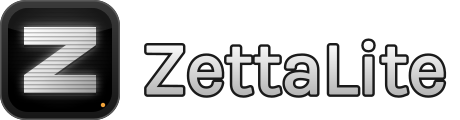
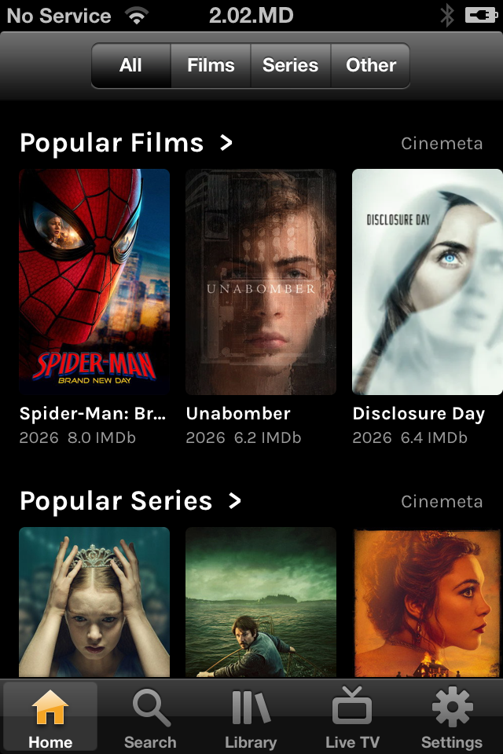
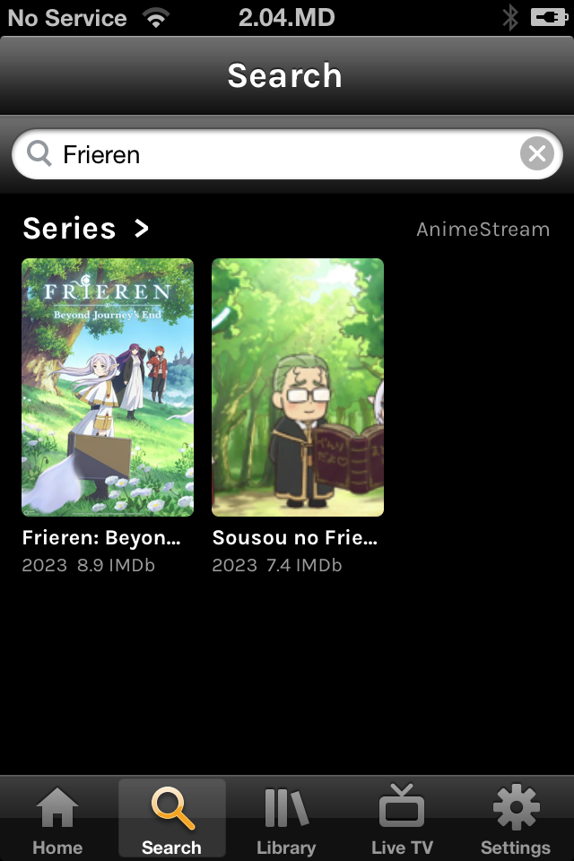
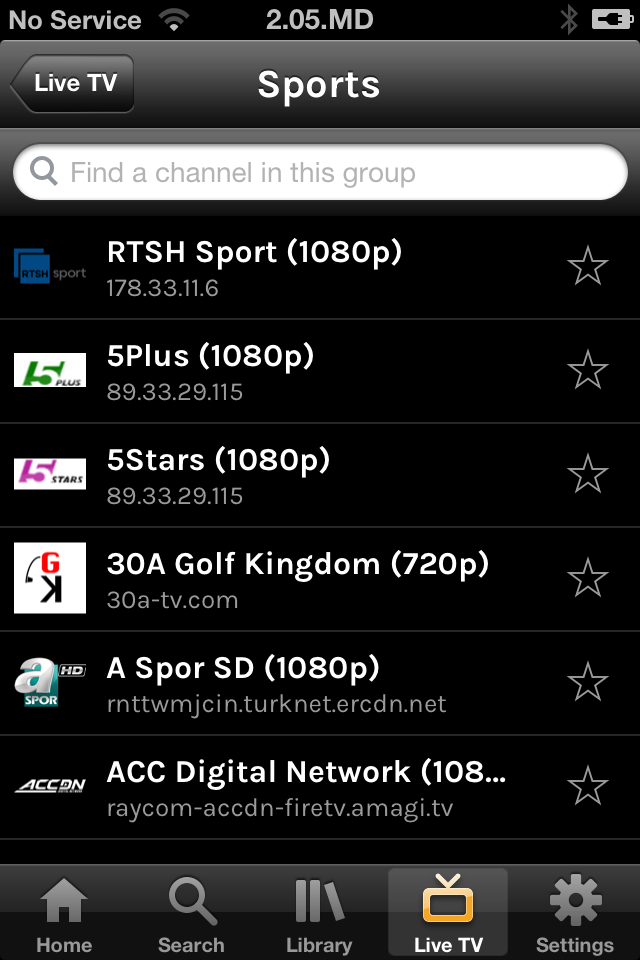

<div align="center">



### Stremio addons and IPTV for the iPhone 4S on iOS 6

_Native UIKit, FFmpeg on the phone, HTTP streams only_


[](LICENSE)
[](https://github.com/Stiven-Gjekaj/ZettaLite/releases/latest)
[](https://ko-fi.com/stivengjekaj)

<p align="center">
  <a href="#overview"><b>Overview</b></a> |
  <a href="#install"><b>Install</b></a> |
  <a href="#add-your-sources"><b>Sources</b></a> |
  <a href="#build"><b>Build</b></a> |
  <a href="docs/architecture.md"><b>Architecture</b></a> |
  <a href="TODO.md"><b>Roadmap</b></a>
</p>

</div>

---

> [!NOTE]
> **Version 1.1.0 is out.** It shows the catalogs of your Stremio addons,
> plays their HTTP streams, keeps a library on the phone, plays IPTV
> playlists as live TV, and shows subtitles.
> [CHANGELOG.md](CHANGELOG.md) lists the changes of each release.
> [docs/decisions.md](docs/decisions.md) holds each decision and its reason.

---

<table>
<tr>
<td width="33%" valign="top">

<p align="center"><i>The catalogs of your addons</i></p>
</td>
<td width="33%" valign="top">

<p align="center"><i>Search in all your addons</i></p>
</td>
<td width="33%" valign="top">

<p align="center"><i>Live TV from M3U playlists</i></p>
</td>
</tr>
</table>

## Overview

**ZettaLite** brings [ZettaStream](https://github.com/Stiven-Gjekaj/ZettaStream)
to an iPhone 4S with iOS 6.1.3. It reads Stremio addons, IPTV playlists, and
single media links, and it plays their HTTP streams. It looks like the other
apps of iOS 6, in black with an amber accent and the Karla font.

The movie player of iOS 6 plays H.264 and AAC in MP4 or HLS, and nothing
else. ZettaLite carries FFmpeg on the phone. FFmpeg reads MKV, WebM, MP4,
MPEG-TS, HLS, and DASH, and changes each stream into HLS segments that a
small server in the app gives to the player on `127.0.0.1`. When the A5 chip
cannot decode the video, for example HEVC, VP9, or AV1, the app plays it with
its own software player. [docs/architecture.md](docs/architecture.md) tells
how.

The TLS of iOS 6 cannot speak to most servers of today, so the app brings
mbedTLS with TLS 1.2 and the Mozilla root certificates.

## Features

- Five tabs: Home, Search, Library, Live TV, and Settings
- Rows of posters from the catalogs of each addon, with a banner and a
  filter for films, series, and other kinds
- A page for each title: the facts, the seasons and episodes, and "More like
  this"
- Streams from all addons at the same time. Play starts the best stream that
  the phone can play, and the next one when a stream fails
- MKV, WebM, MP4, MPEG-TS, HLS, and DASH. AC3, E-AC3, DTS, Opus, FLAC, and
  other audio change into AAC on the phone
- A software player for HEVC, VP9, AV1, MPEG-2, and 10-bit H.264
- Continue watching, a watchlist, watched marks, and New episodes. The
  library stays on the phone
- A countdown to the next episode, from the same source and quality
- Live TV from M3U playlists, with groups, logos, search, and favourite
  channels
- Subtitles from subtitle addons and from inside MKV and MP4 files
- Backup and restore of the library, the sources, and the settings
- Open `zettalite://` links from other apps and Safari bookmarklets

Version 1.0.0 was checked on an iPhone 4S with iOS 6.1.3.

## Install

You need an iPhone, iPod touch, or iPad with iOS 6 and a jailbreak.

1. Download the `.deb` file from the
   [latest release](https://github.com/Stiven-Gjekaj/ZettaLite/releases/latest).
2. Copy it to the phone, for example with `scp` to `/tmp/`.
3. On the phone, as root: `dpkg -i /tmp/io.github.stivengjekaj.zettalite_*.deb`.

The ZettaLite icon comes on the home screen. To remove the app:
`dpkg -r io.github.stivengjekaj.zettalite`.

On iOS 7 or later, or with an APT that has TLS 1.2, you can also add the
Cydia source `https://stiven-gjekaj.github.io/cydia/`. Cydia then shows the
updates. Cydia on iOS 6 cannot read it, because its APT stops at TLS 1.0
and GitHub accepts only TLS 1.2. See
[the repository](https://github.com/Stiven-Gjekaj/cydia).

## Add your sources

ZettaLite comes with no sources. Open Settings, then Sources, paste your
list, and press Save. Put one link on each line:

| Line | Example | Gives |
| ---- | ------- | ----- |
| A Stremio addon | `https://.../manifest.json` | Catalogs, titles, streams, subtitles |
| An IPTV playlist | `https://.../playlist.m3u` | Live channels |
| A media link | `https://.../film.mkv` | One video, in the Links group of Live TV |

The new list replaces the old list. The order of the lines sets the order of
the rows on Home. A line that starts with `#` is a note.

ZettaLite plays HTTP streams only. It has no torrents. A torrent addon gives
HTTP links when you add a debrid key in its settings.

Live TV reads the `#EXTINF` attributes `tvg-logo`, `tvg-id`, and
`group-title`, and the headers of `#EXTVLCOPT`, `#EXTHTTP`, and of a link
with `|`. A `.m3u8` link that is one HLS stream shows as one channel. The
star marks a favourite channel. The favourites show first.

## Subtitles

The player shows SRT and WebVTT subtitles from subtitle addons, for example
OpenSubtitles v3, and the text subtitles inside MKV and MP4 files. Choose
the language and the size in Settings, Playback. Subs in the player shows
the choices. Bitmap subtitles, for example PGS, do not show.

## Links from other apps

Each value is percent-encoded.

| Link | Does |
| ---- | ---- |
| `zettalite://play?url=URL&t=SECONDS` | Plays URL, from SECONDS |
| `zettalite://title?type=TYPE&id=ID` | Opens the page of a title, for example `type=movie&id=tt0111161` |
| `zettalite://watch?type=TYPE&id=ID` | Plays the best stream of a title, or of an episode with `id=tt0944947:1:2` |
| `zettalite://search?q=TEXT` | Searches in all addons |
| `zettalite://tab?name=NAME` | Opens `home`, `search`, `library`, `live`, or `settings` |
| `zettalite://live?group=NAME` | Opens a group of channels in Live TV |
| `zettalite://live?channel=NAME` | Plays the first channel with this name |

Settings, Play a link plays one pasted link.

## How ZettaLite differs from ZettaStream

- It runs on an iPhone with iOS 6, not on Android.
- It plays HTTP streams only. It has no torrents.
- It has no profiles, AniSkip, trailers, video filters, or TV guide.
- It is written in Objective-C and builds with shell scripts, not with
  Gradle.

## Build

You need a Mac with Xcode, the iOS 9.3 SDK of Theos, and `rsvg-convert` and
`dpkg-deb` from Homebrew. The media tests also need `ffmpeg` on the Mac.

1. Download `iPhoneOS9.3.sdk.tar.xz` from the releases of
   [theos/sdks](https://github.com/theos/sdks/releases) and unpack it into
   `sdks/`. The result is `sdks/iPhoneOS9.3.sdk`. Git does not track `sdks/`.
2. Run `./fix-sdk.sh` one time. It changes the SDK stubs for the new Apple
   linker and for iOS 6.
3. Build:

| Command | Result |
| ------- | ------ |
| `scripts/app.sh` | `build/ZettaLite.app`. It builds FFmpeg and mbedTLS the first time. |
| `scripts/deb.sh` | The Cydia package in `build/` |
| `scripts/install.sh` | Builds the app, copies it to the phone, and opens it |
| `scripts/test.sh` | The tests of `src/core`, on the Mac |
| `scripts/test.sh --phone` | All the tests, on the phone |
| `ZL_LIVE=1 scripts/test.sh` | Also the tests that use the internet |
| `scripts/fixtures.sh` | The media files and the test addon in `build/fixtures/` |
| `scripts/ffmpeg.sh` | FFmpeg as one LGPL dylib in `build/ffmpeg/` |
| `scripts/mbedtls.sh` | mbedTLS in `build/mbedtls/` |

The phone scripts use `ssh iphone4s`. Set up that host in `~/.ssh/config`,
for example with a USB tunnel of `iproxy` on port 2222.

`build.sh` builds one armv7 binary. It compiles with ARC and links without
ARC, and all code is in ARM mode (`-marm`). The new Apple linker makes Thumb
code that crashes on iOS 6 before `main` starts.

To run a tool on the phone:

```
./build.sh build/X probe/X.m -framework Foundation
scp build/X iphone4s:/tmp/
ssh iphone4s 'ldid -S /tmp/X && /tmp/X'
```

`probe/` holds the tools: `ffprobe.m` reads a media URL, `remux.m` makes
HLS segments, `bench.m` and `aacbench.m` measure the decoders, and `shot.m`
saves a screenshot.

## Support

If you find ZettaLite useful, you can support its development here.

[](https://ko-fi.com/stivengjekaj)

## A note on rights

ZettaLite is a player. It contains no media and no sources, and the project
does not recommend any. You choose your sources, and you are responsible for
them and for what you watch.

## Licence

MIT. See [LICENSE](LICENSE). The app includes FFmpeg (LGPL 2.1), dav1d
(BSD 2-Clause), mbedTLS (Apache 2.0), and the Mozilla root certificates
(MPL 2.0). See [docs/architecture.md](docs/architecture.md#third-party-code).
The Karla font is under the SIL Open Font License, in
[licenses/](licenses/Karla-OFL.txt).
